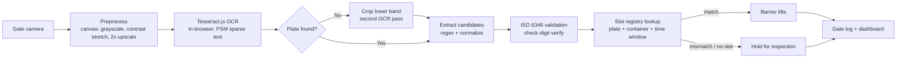

# GateWatch — AI Gate Automation for Ports

**Computer vision at the terminal gate: read every plate and container number, verify it against the appointment slot, and clear the truck in ~20 seconds instead of ~3 minutes.**

GateWatch is a working demo of an automated gate pipeline, built around the real bottleneck at the **Port of Casablanca**: just **3 terminal gates**, trucks queuing **up to 12 hours**, and throughput collapsed from ~2,800 to ~900 containers/day. Manual plate-and-container checks take minutes per truck. GateWatch turns that check into seconds — no new concrete required.

> **Live demo:** *(production URL goes here after Vercel deploy)*

---

## The problem

Casablanca handles ~65% of Morocco's foreign trade. Its landside crisis has five interlocking causes — but the gate is the one chokepoint every truck must pass:

| Factor | Reality |
|---|---|
| Gates | 3 manual checkpoints for the whole terminal |
| Verification | Plate + container number read by eye, ~3 min/truck |
| Peak waits | Up to 12 hours for trucks |
| Throughput | ~2,800 → ~900 containers/day |

You can't pour concrete fast enough. You can automate the check.

## The ROI math

| Metric | Manual gate | GateWatch |
|---|---|---|
| Verification time | ~180 s | ~20 s |
| Trucks / hour / gate | ~20 | ~180 |
| 3-gate throughput | ~60/hr | ~540/hr |
| Read errors | Manual, disputed | ISO 6346 check-digit validated |
| Audit trail | Paper / memory | Every crossing timestamped + logged |

**≈9× gate throughput without building a fourth gate.** Faster gates also cut truck idling (fuel + CO₂), demurrage disputes (every read is logged with a timestamp), and the queue spilling onto city roads.

*Engineering estimates for the demo (180 s manual vs 20 s automated). Real-world throughput also depends on yard and customs capacity downstream.*

## How it works

```
 ┌─────────┐    ┌─────────────┐    ┌──────┐    ┌──────────┐    ┌────────┐    ┌─────┐
 │ Camera  │───▶│ Preprocess  │───▶│ OCR  │───▶│ Validate │───▶│ Verify │───▶│ Log │
 │(gate)   │    │(grayscale,  │    │(Tess-│    │(ISO 6346 │    │(slot   │    │(dash│
 │         │    │ contrast,   │    │eract │    │ check    │    │registry│    │board)│
 │         │    │ 2× upscale) │    │.js)  │    │ digit)   │    │)      │    │     │
 └─────────┘    └─────────────┘    └──────┘    └──────────┘    └────────┘    └─────┘
```



### The two-pass OCR trick

Plates sit low in gate-camera frames, and page-level layout analysis routinely skips them. GateWatch runs OCR on the full frame, and **if no plate candidate is found, it automatically re-scans the lower 45% as a second pass** — the same approach real ANPR deployments use with a dedicated plate camera. Container numbers follow **ISO 6346** (4 letters + 6 digits + check digit); the check digit is validated per the standard, so misreads are caught, not trusted.

Everything runs **in the browser** (Tesseract.js, no server GPU, no image uploads) — it deploys on existing gate-camera hardware with a static host.

## App tour

- **`/`** — Marketing landing: the problem, the ROI math, how it works. This is the sales pitch.
- **`/demo`** — Guided live demo: pick a sample capture (or upload a truck photo) → watch OCR + preprocessing → review extracted plate/container with ISO 6346 validation → verify against the slot registry → log the crossing.
- **`/dashboard`** — Operations view: gate log, trucks/hour, avg check time, mismatch rate, hourly throughput chart, outcome donut. "Load sample shift" fills a realistic day.
- **`/registry`** — Appointment-slot CRUD (plate, container, company, line, gate, time window). Persists in `localStorage`; reset to demo data anytime.

## Sample images

`public/samples/` contains 4 synthetic gate-camera captures (1600×1000) with valid ISO 6346 numbers and Moroccan-format plates:

| File | Container | Plate |
|---|---|---|
| `sample-1-tclu.jpg` | TCLU 482913-2 | — |
| `sample-2-msku.jpg` | MSKU 739201-7 | 78452-A-17 |
| `sample-3-gesu.jpg` | GESU 556720-2 | — |
| `sample-4-fciu.jpg` | FCIU 908134-3 | 91208-B-45 |

They're renders, not photos — built for OCR reliability so the demo works on first click. The matching appointment slots are pre-seeded in the registry.

## Run it

```bash
npm install
npm run dev      # http://localhost:3000
npm test         # vitest — 26 tests
npm run build    # production build
```

Deploys as-is on Vercel (`npm run build` / `next start`).

## Project structure

```
src/
  app/
    page.tsx            # landing (the pitch)
    demo/page.tsx       # guided OCR + verification demo
    dashboard/page.tsx  # gate log, stats, SVG charts
    registry/page.tsx   # slot CRUD
  components/           # Navbar, Footer, UploadZone, StepIndicator, ui primitives
  lib/
    ocr.ts              # Tesseract.js wrapper, preprocessing, region re-scan
    iso6346.ts          # check-digit math, parsing, candidate extraction
    plates.ts           # Moroccan plate normalization
    slots.ts            # slot matching (match / mismatch / no-slot / outside-window)
    registry.ts         # seed data + localStorage
    gatelog.ts          # log types + statistics
    preprocess.ts       # pure pixel pipeline (grayscale, contrast, Otsu, upscale)
```

## Honest limitations

- **Demo-grade OCR.** Tesseract.js is real OCR, but accuracy depends on image quality: sharp, well-lit, front-facing text. Rain, night, skewed angles, and dirty plates degrade it — production deployments pair this pipeline with fixed IR-illuminated gate cameras and a text-detection front end (e.g., YOLO-based region detection) before OCR.
- **Simplified plates.** The demo uses `NNNNN-L-NN` plates; real Moroccan plates include Arabic-script region codes.
- **Mock registry.** Slots live in `localStorage`; production syncs with the terminal operating system (TOS).
- **Estimates, not guarantees.** The 9× figure is arithmetic on 180 s vs 20 s checks, not a measured deployment.

## Production roadmap

1. Text-detection front end (bounding boxes → per-region OCR) replacing full-frame passes
2. TOS integration for live slot data
3. Plate-model fine-tuning on Moroccan plates (Arabic script)
4. Edge deployment (Jetson / on-prem) for sub-second latency
5. ANPR camera presets per gate lane

## License

MIT — see [LICENSE](LICENSE).
