# GateWatch — AI Gate Automation for Ports

**Computer vision at the terminal gate: read every plate and container number, verify it against the appointment slot, and clear the truck in ~20 seconds instead of ~3 minutes.**

GateWatch is a working demo of an automated gate pipeline, built around the real bottleneck at the **Port of Casablanca**: just **3 terminal gates**, trucks queuing **up to 12 hours**, and throughput collapsed from ~2,800 to ~900 containers/day. Manual plate-and-container checks take minutes per truck. GateWatch turns that check into seconds — no new concrete required.

> **Live demo:** https://gatewatch-8cj6b60eq-eliem08s-projects.vercel.app

---

## The problem

Casablanca handles ~65% of Morocco's foreign trade. Its landside crisis has five interlocking causes — but the gate is the one chokepoint every truck must pass:

| Factor | Reality |
|---|---|
| Gates | 3 manual checkpoints for the whole terminal |
| Verification | Plate + container number read by eye, ~3 min/truck |
| Peak waits | Up to 12 hours for trucks |
| Throughput | ~2,800 → ~900 containers/day |

You can't pour concrete fast enough. You can automate the check.

## The ROI math

| Metric | Manual gate | GateWatch |
|---|---|---|
| Verification time | ~180 s | ~20 s |
| Trucks / hour / gate | ~20 | ~180 |
| 3-gate throughput | ~60/hr | ~540/hr |
| Read errors | Manual, disputed | ISO 6346 check-digit validated |
| Audit trail | Paper / memory | Every crossing timestamped + logged |

**≈9× gate throughput without building a fourth gate.** Faster gates also cut truck idling (fuel + CO₂), demurrage disputes (every read is logged with a timestamp), and the queue spilling onto city roads.

*Engineering estimates for the demo (180 s manual vs 20 s automated). Real-world throughput also depends on yard and customs capacity downstream.*

## How it works

```
 ┌─────────┐    ┌─────────────┐    ┌──────────┐    ┌──────────┐    ┌────────┐    ┌─────┐
 │ Camera  │───▶│ Preprocess  │───▶│ Ensemble │───▶│ Validate │───▶│ Verify │───▶│ Log │
 │(gate)   │    │(denoise,    │    │ OCR      │    │(ISO 6346 │    │(slot   │    │(dash│
 │         │    │ equalize,   │    │(4× Tess- │    │ check    │    │registry│    │board)│
 │         │    │ deskew,     │    │ eract    │    │ digit,   │    │)      │    │     │
 │         │    │ threshold,  │    │ PSM vote)│    │ owner)   │    │      │    │     │
 │         │    │ 2× upscale) │    │          │    │          │    │      │    │     │
 └─────────┘    └─────────────┘    └──────────┘    └──────────┘    └────────┘    └─────┘
```



```mermaid
flowchart LR
    CAM[Gate camera] --> PRE[Preprocess\ncanvas: denoise, equalize, deskew, threshold, 2x upscale]
    PRE --> OCR[Ensemble OCR\nTesseract.js, PSM 6/7/11/13, confidence-weighted vote]
    OCR --> PLATE{Plate found?}
    PLATE -- No --> CROP[Crop lower band\n5th vote: PSM 3]
    CROP --> EXTRACT
    PLATE -- Yes --> EXTRACT[Extract candidates\nregex + normalize]
    EXTRACT --> ISO[ISO 6346 validation\ncheck-digit verify + owner lookup]
    ISO --> SLOT[Slot registry lookup\nplate + container + time window]
    SLOT -->|match| GREEN[Barrier lifts]
    SLOT -->|mismatch / no-slot| RED[Hold for inspection]
    GREEN --> LOG[Gate log + dashboard]
    RED --> LOG
```

### The two-pass OCR trick

Plates sit low in gate-camera frames, and page-level layout analysis routinely skips them. GateWatch runs OCR on the full frame, and **if no plate candidate is found, it automatically re-scans the lower 45% as a fifth vote (PSM 3)** — the same approach real ANPR deployments use with a dedicated plate camera. Container numbers follow **ISO 6346** (4 letters + 6 digits + check digit); the check digit is validated per the standard, so misreads are caught, not trusted.

### Ensemble OCR: why four passes beat one

A single Tesseract pass commits to one layout analysis, and on gate photos the layout guess is often the failure. GateWatch runs four passes (PSM 6, 7, 11, 13), parses each pass into plate/container candidates, and picks the winner by **confidence-weighted vote**. Different layout modes make different mistakes, so the vote cancels uncorrelated errors — the same principle as multi-engine OCR combination (Lund & Ringger 2009) and multi-binarization voting (Lund, Kennard & Ringger 2013). The demo shows every engine's read and the agreement rate, so a split vote is visible instead of hidden.

### Preprocessing pipeline (all steps toggleable, per-step timing)

Grayscale → denoise (3×3 median) → equalize (histogram or CLAHE) → deskew (Hough accumulator) → contrast stretch → threshold (Otsu or adaptive local-mean) → 2× upscale. The demo shows a before/after toggle and the milliseconds each step took. Full rationale, failure modes, and references: `/methodology`.

Everything runs **in the browser** (Tesseract.js, no server GPU, no image uploads) — it deploys on existing gate-camera hardware with a static host.

## App tour

- **`/`** — Marketing landing: the problem, the ROI math, how it works. This is the sales pitch.
- **`/demo`** — Guided live demo: pick a sample capture (or upload a truck photo) → watch OCR + preprocessing → review extracted plate/container with ISO 6346 validation → verify against the slot registry → log the crossing.
- **`/batch`** — Batch mode: drop many gate captures at once. Each image is assigned to one of 3 lanes and scanned in queue order; reads below the operator-set confidence threshold go to the human review queue instead of auto-accepting. Verified results land in the gate log in order.
- **`/dashboard`** — Operations view: gate log, trucks/hour, avg check time, mismatch rate, hourly throughput chart, outcome donut, per-lane throughput, OCR accuracy panel (auto-accept rate, correction rate), and one-click CSV export of the gate log. "Load sample shift" fills a realistic day.
- **`/benchmark`** — Evaluation harness: 4 labeled samples × 6 degradations (clean, noise, blur, rotation, low contrast, occlusion), scored with CER / WER / field accuracy, plus a confusion matrix of benchmark errors and the error-analysis dashboard built from human corrections.
- **`/methodology`** — Research write-up: pipeline diagram, ISO 6346 check-digit math with a worked example, BIC owner-code registry, failure modes, production requirements, honest limits, and verified references.
- **`/registry`** — Appointment-slot CRUD (plate, container, company, line, gate, time window). Persists in `localStorage`; reset to demo data anytime.

## Batch mode, review queue & lanes

**Batch processing.** Drag-and-drop or browse for many images at once (or "Add all 4 samples"). Items process strictly in queue order with per-image status (`queued → processing → done / failed`) and a progress bar. A failed scan never blocks the queue — the next item starts immediately.

**Human review queue.** Every scan whose OCR confidence falls below the operator-set threshold (default 70%, adjustable) is routed to review instead of auto-accepting. The operator sees the capture, the OCR read, and editable plate/container fields, then approves as-is or saves a correction. Every decision is recorded: the dashboard's accuracy panel reports the auto-accept rate (scans that never needed a human) and the correction rate (reviewed reads the operator actually changed).

**3 lane simulation.** Each batch item is assigned to the least-loaded of 3 lanes (ties → lowest lane number) when processing starts; each lane tracks its own processed count and average scan time, and the dashboard shows per-lane throughput. The lanes share one browser OCR engine in this demo, so scans serialize in queue order — production lanes each run their own reader.

**CSV export.** The dashboard's "Export CSV" button downloads the gate log (`timestamp,image,plate,container,iso_valid,result,gate,lane,processing_ms,reviewed,corrected`), oldest-first, RFC 4180 escaping.

**Moroccan plate coverage.** Beyond the current `NNNNN-L-NN` series, the parser accepts 2-letter series (`78452-AB-17`, used once single letters ran out), WW temporary plates in both orders (`WW-123456`, `123456-WW`), and an optional region suffix using the Latin transliteration codes from export/transit paperwork (`78452-A-17-CAS`, `…-RAB`, `…-FES`, 35 city codes). Only known region codes count as a suffix — any other trailing word is treated as OCR noise.

## Evaluation harness & error analysis

`/benchmark` runs the **labeled test set** (the 4 SVG samples, ground truth in `src/lib/benchmark.ts`) under **6 degradations** — clean, Gaussian noise (σ=25, seeded), blur, +4° rotation, low contrast (40% range), occlusion bars — and scores each case:

- **CER** — character error rate = Levenshtein distance / reference characters.
- **WER** — word error rate = word-level edit distance / reference words.
- **Field accuracy** — fraction of present plate/container fields recovered exactly.
- **Confusion matrix** — which characters were misread as which (0→O, 1→I, …), from Levenshtein alignment of errors.

Degradations are seeded, so runs are reproducible. The benchmark runs single-pass (PSM 6) by default; the ensemble mode runs all 4 PSM passes per case (~4× slower).

**Error analysis from human corrections.** Every correction an operator makes in the review queue is aligned (OCR read vs. correction) and appended to a persistent confusion log (`gatewatch.confusion.v1`). The benchmark page aggregates it: most-confused pairs, split by preprocessing on/off, by quality bucket, and by field. This is the ground truth for what the system actually gets wrong in the field — and the input for deciding which preprocessing step or engine earns its keep.

## ISO 6346 deep-dive + BIC owner codes

The check digit: letters map to numbers (A=10, B=12, C=13, …, Z=38 — multiples of 11 skipped), each of the first 10 characters is weighted by 2⁰…2⁹, summed, mod 11 (10 → 0). Worked example, `CSQU 305438 3`:

```
C=13  S=30  Q=28  U=32  3  0  5  4  3  8
×1   ×2   ×4   ×8  ×16 ×32 ×64 ×128 ×256 ×512
= 13 + 60 + 112 + 256 + 48 + 0 + 320 + 512 + 768 + 4096 = 6185
6185 mod 11 = 3 ✓
```

The first 4 letters are the **BIC owner code**. GateWatch ships a partial registry (major carriers + lessors, e.g. MSKU/Maersk, MSCU/MSC, CMAU/CMA CGM, HLCU/Hapag-Lloyd, COSU/COSCO, EGLV/Evergreen, ONEU/ONEY/ONE, HDMU/HMM, ZIMU/ZIM, YMLU/Yang Ming, plus Triton/Textainer/Florens/GE SeaCo/Beacon). Unknown code = not in this demo registry, not an error. Full registry + method: `/methodology`.

## Sample images

`public/samples/` contains 4 synthetic gate-camera captures (1400×875 SVG, text as vector paths — renders identically everywhere) with valid ISO 6346 numbers and Moroccan-format plates:

| File | Container | Plate |
|---|---|---|
| `sample-1-tclu.svg` | TCLU 482913-2 | — |
| `sample-2-msku.svg` | MSKU 739201-7 | 78452-A-17 |
| `sample-3-gesu.svg` | GESU 556720-2 | — |
| `sample-4-fciu.svg` | FCIU 908134-3 | 91208-B-45 |

They're renders, not photos — built for OCR reliability so the demo works on first click. The matching appointment slots are pre-seeded in the registry.

## Run it

```bash
npm install
npm run dev      # http://localhost:3000
npm test         # vitest — 87 tests
npm run build    # production build
```

Deploys as-is on Vercel (`npm run build` / `next start`).

## Project structure

```
src/
  app/
    page.tsx            # landing (the pitch)
    demo/page.tsx       # guided OCR + verification demo (ensemble + timed pipeline)
    batch/page.tsx      # batch queue, 3 lanes, human review queue, accuracy
    dashboard/page.tsx  # gate log, stats, lane + accuracy panels, CSV export
    benchmark/page.tsx  # evaluation harness + error-analysis dashboard
    methodology/page.tsx# pipeline, ISO 6346 math, BIC registry, limits, references
    registry/page.tsx   # slot CRUD
  components/           # Navbar, Footer, UploadZone, BatchDropzone, StepIndicator, ui primitives
  lib/
    ocr.ts              # Tesseract.js wrapper, timed preprocessing, ensemble, region re-scan
    iso6346.ts          # check-digit math, parsing, candidate extraction
    plates.ts           # Moroccan plate normalization (2-letter series, WW, region codes)
    slots.ts            # slot matching (match / mismatch / no-slot / outside-window)
    registry.ts         # seed data + localStorage
    gatelog.ts          # log types + statistics
    batch.ts            # batch queue (FIFO, per-item status)
    review.ts           # review queue + accuracy accounting
    lanes.ts            # 3-lane assignment + per-lane stats
    export.ts           # gate-log CSV export (RFC 4180)
    preprocess.ts       # pure pixel pipeline (grayscale, contrast, Otsu, upscale)
    advancedPreprocess.ts # histogram equalization, CLAHE, median denoise,
                        #   adaptive threshold, Hough deskew, rotation
    degrade.ts          # seeded synthetic degradations (noise, blur, rotate, …)
    metrics.ts          # Levenshtein, CER, WER, field accuracy, confusion pairs
    ensemble.ts         # multi-PSM voting (confidence-weighted field vote)
    benchmark.ts        # labeled test set + benchmark runner + aggregation
    confusion.ts        # review-correction confusion log + aggregation
    owners.ts           # partial BIC owner-code registry
    citations.ts        # verified references
```

## References

Every citation was verified to exist before being listed:

- Otsu, N. (1979). *A Threshold Selection Method from Gray-Level Histograms.* IEEE Trans. Systems, Man, and Cybernetics, 9(1), 62–66.
- Smith, R. (2007). *An Overview of the Tesseract OCR Engine.* Proc. ICDAR 2007, vol. 2, 629–633.
- Lund, W. B. & Ringger, E. K. (2009). *Improving Optical Character Recognition through Efficient Multiple System Alignment.* Proc. JCDL 2009, 231–240.
- Lund, W. B., Kennard, D. J. & Ringger, E. K. (2013). *Combining Multiple Thresholding Binarization Values to Improve OCR Output.* Proc. DRR XX.
- Levenshtein, V. I. (1966). *Binary Codes Capable of Correcting Deletions, Insertions, and Reversals.* Soviet Physics Doklady, 10(8), 707–710.
- Anagnostopoulos, C.-N. E. et al. (2008). *License Plate Recognition From Still Images and Video Sequences: A Survey.* IEEE Trans. ITS, 9(3), 377–391.
- ISO 6346:2022. *Freight containers — Coding, identification and marking.*

## Honest limitations

- **Demo-grade OCR.** Tesseract.js is real OCR, but accuracy depends on image quality: sharp, well-lit, front-facing text. Rain, night, skewed angles, and dirty plates degrade it — production deployments pair this pipeline with fixed IR-illuminated gate cameras and a text-detection front end (e.g., YOLO-based region detection) before OCR.
- **Synthetic benchmark.** The labeled test set is 4 SVG renders, not real photos. Benchmark numbers measure robustness to synthetic degradation, not real-world accuracy. A production sign-off needs hundreds of labeled real gate frames.
- **Ensemble votes on fields, not aligned strings.** It cannot correct a character every engine misreads the same way (e.g. a badly occluded 0). The check digit and the review queue are the backstop for those cases.
- **Plates: transliteration, not Arabic script.** The parser covers the Latin-script forms (including 2-letter series, WW temporary plates, and Latin region-code suffixes). Real Moroccan plates carry the region code in Arabic script, which this English-model OCR cannot read — a production reader needs an Arabic-script model or a dedicated plate recognizer.
- **Lanes share one OCR engine.** Batch items serialize through a single in-browser Tesseract worker in queue order; the lane assignment and per-lane stats are real, but the lanes are not truly parallel here. Production lanes each run their own reader.
- **Review thumbnails are session-bound.** Pending review items whose image was an uploaded file lose their thumbnail after a page reload (browser object URLs don't persist); decided review history and accuracy stats survive. Sample-image reviews keep their thumbnails.
- **Mock registry.** Slots live in `localStorage`; production syncs with the terminal operating system (TOS).
- **Estimates, not guarantees.** The 9× figure is arithmetic on 180 s vs 20 s checks, not a measured deployment.

## Production roadmap

1. Text-detection front end (bounding boxes → per-region OCR) replacing full-frame passes
2. TOS integration for live slot data
3. Plate-model fine-tuning on Moroccan plates (Arabic script)
4. Edge deployment (Jetson / on-prem) for sub-second latency
5. ANPR camera presets per gate lane

## License

MIT — see [LICENSE](LICENSE).
